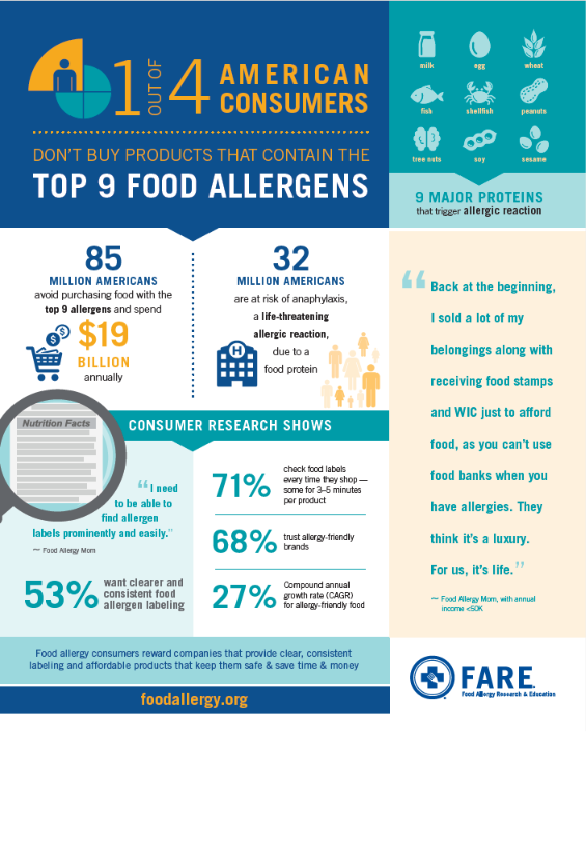

# 👁️ Divya Drishti — Food Allergens Hidden in U.S. Medications

**Phase 1 of Sanjeevani Aushad · SIADS 521 — Assignment 3 (Information Visualization)**

How widespread are major food allergens — including **alpha-gal** (mammalian-derived) —
across FDA-approved medications, and does the prevalence depend on **how a drug is taken**
(its route of administration)?

This is a **descriptive-indicators** study over openFDA drug labels: a transparent,
rule-based, auditable pipeline that tags each medication's allergens and lets you explore the
result. It is **human-in-the-loop** by design — a *Review* status flags what a person still
has to confirm.

> ⚠️ **Educational prototype — not medical advice.** A "Detected" tag is not a safety guarantee;
> always verify the physical product and consult a clinician.

**▶ Live dashboard:** https://saddph1siads521.streamlit.app/

---

## 1. The problem — why this matters

Food allergens hide in medication *inactive* ingredients (e.g., **lactose**, a milk derivative,
is a common tablet filler), yet prescribing and dispensing rarely cross-check them against a
patient's known allergies. Finding a compatible medication can take more than one try — the
patient ends up as the system integrator.

<p align="center">
  
</p>

<p align="center">
  
</p>

## 2. How the data is built (provenance)

*Dataset creation is upstream of this assignment — shown here so the story is reproducible.*

<p align="center">
  
</p>

- **Source:** openFDA Drug Label (public domain) — file 1 of 14, **~20,000 records**.
- **Pipeline:** `01_DatasetCreation_4Status.py` → `02_DatasetCreation_AllergenSummary.py`
  (run both via `05_Main.py`). Each medication's allergens are tagged
  **Detected / Review / Not Detected / Unknown** using direct rules, review rules, and exclusions.
- **Outputs** (`output/`): the tagged master dataset + allergen summaries.

## 3. The visualizations

Interactive (Plotly) in the notebook; the dashboard links them under a single allergen filter.
Order matches the dashboard flow — scope, then explore one allergen, then the cleanup view.

| # | Chart | What it shows |
| - | ----- | ------------- |
| 1 | Pie | overall status — Detected / Review / Not Detected |
| 2 | Bar | prevalence per allergen |
| 3 | Route signature *(interactive)* | one allergen's spread across routes |
| 4 | Worst offenders *(interactive)* | the exact ingredient words driving each allergen |
| 5 | Sunburst ⭐ *(interactive)* | allergen → route → status *(new-to-course method)* |
| 6 | Waffle ⭐ | how many allergens a single medication carries *(new-to-course method)* |
| 7 | Why "Review"? *(interactive)* | the next-cleaning worklist |

*The **heatmap** (allergen × route) is kept in the notebook as a 4th technique, but left out of the dashboard — the sunburst now covers route × allergen.*

## 4. Interactive dashboard

`SA_DD_PH1_SIADS521_Assignment3_dashboard.py` (Streamlit) — pick one allergen and the whole
page reconfigures (scope → explore → cleanup).

**▶ Live:** https://saddph1siads521.streamlit.app/

Run locally:
```bash
pip install -r requirements.txt
streamlit run SA_DD_PH1_SIADS521_Assignment3_dashboard.py
```

## Files in this folder

| File | What it is |
| ---- | ---------- |
| `SA_DD_PH1_SIADS521_Assignment3_notebook.ipynb` | the assignment notebook (story + charts) |
| `SA_DD_PH1_SIADS521_Assignment3_dashboard.py` | the interactive Streamlit dashboard |
| `01_DatasetCreation_4Status.py` | rule-based allergen tagging (4-status) |
| `02_DatasetCreation_AllergenSummary.py` | per-allergen summary tables |
| `05_Main.py` | runs the pipeline end-to-end |
| `output/` | tagged dataset + allergen summaries |
| `requirements.txt` | Python dependencies |

*Repo: `ushajaki-u/Sanjeeva-Aushadh` · Data: openFDA Drug Label (public domain) · Benchmark: Reker et al., Sci Transl Med 2019.*
